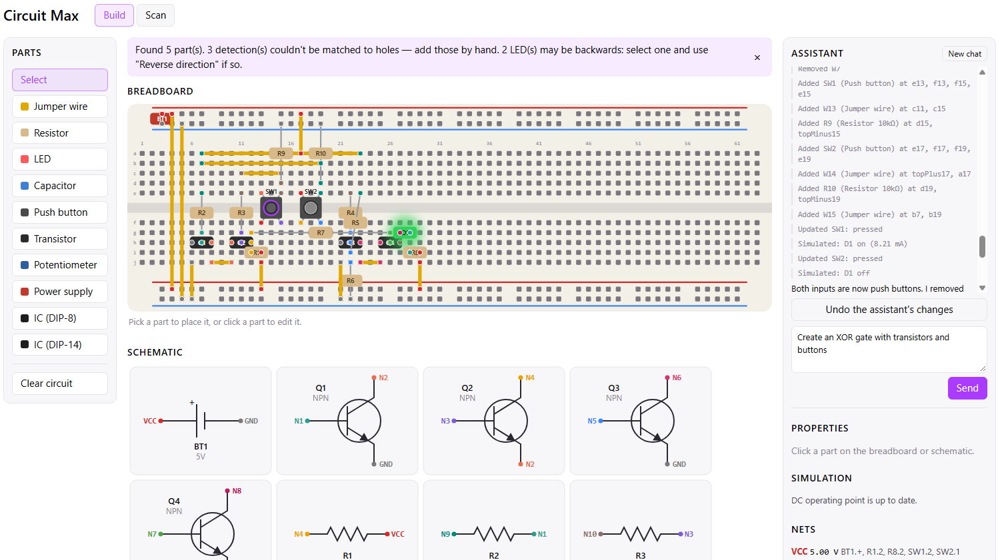
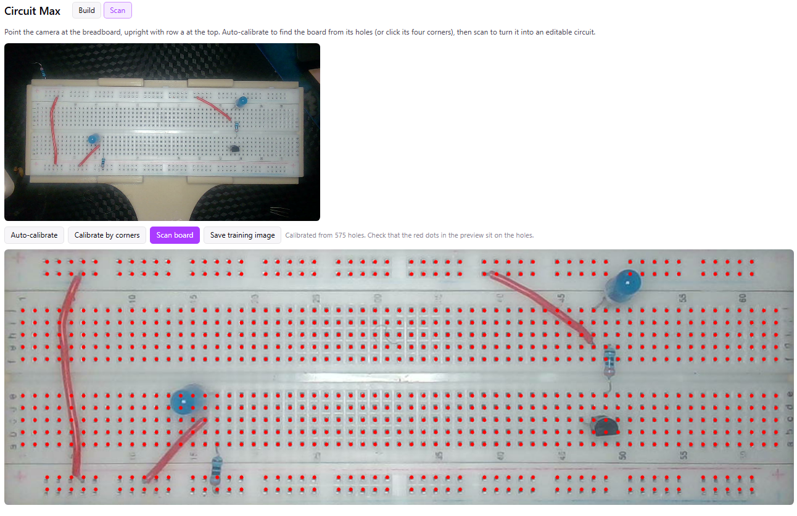
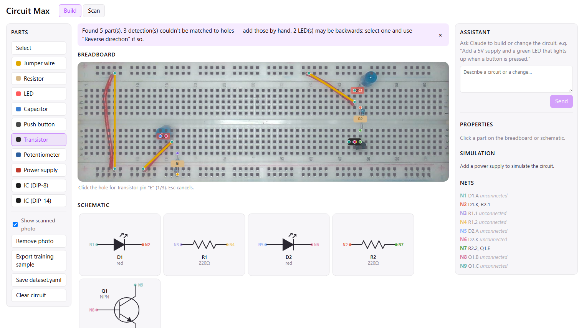

# Circuit Max

Circuit Max is a breadboard workbench in the browser with three parts:

1. **[Simulator and AI assistant](#1-simulator-and-ai-assistant)**: build circuits on a virtual breadboard, watch them simulate live, and ask Claude to build or fix them for you.
2. **[Scanner](#2-scanner)**: point a webcam at a real breadboard, and the app finds the board and every hole on it.
3. **[Scanned simulation](#3-scanned-simulation)**: an object-detection model turns the photo into parts on the virtual board, ready to edit and simulate.

## 1. Simulator and AI assistant



- **Breadboard editor.** Place jumper wires, resistors, LEDs, capacitors, push buttons, transistors, potentiometers, power supplies and DIP ICs. Pins snap to holes, and the editor works out what's connected: each column of five holes, the power rails, and your jumper wires.
- **Live simulation.** Every change re-runs a SPICE DC operating-point simulation in the browser, using ngspice compiled to WebAssembly. LEDs glow with their real brightness, overcurrent is flagged, and you can press buttons and turn potentiometers right on the board.
- **Schematic and nets.** A schematic is drawn from the breadboard automatically, with each net named and coloured (VCC, GND, N1, …) and its voltage shown.
- **AI assistant.** Describe a circuit or a change in plain English. In the screenshot, the request was "Create an XOR gate with transistors and buttons". Claude places the parts, presses the buttons and runs the simulation to check its work, then explains what it built. You can watch the board update as it goes, and undo its changes in one click.

## 2. Scanner



- **Auto-calibration.** Point a webcam at a real breadboard and click **Auto-calibrate**. The app finds the board from its grid of holes, even when parts and wires cover some of them, and handles perspective and a tilted camera. In the screenshot it locked on from 575 holes.
- **Flattened view.** The camera frame is warped into a straight-on view of the board. The red dots show where the app expects each hole, so you can check the fit at a glance.
- **Manual fallback.** If auto-calibration can't find the board (glare, poor light, or the board partly out of view), click its four corners instead.

## 3. Scanned simulation



- **Part detection.** **Scan board** sends the flattened image to a YOLO-pose model, which finds each part and where its legs go into the board. Those positions snap to holes, and the parts appear in the Build tab on top of the photo.
- **Editable and simulated.** Scanned parts are ordinary parts, so you can fix anything the model missed, add a power supply, and simulate the real circuit you built. Or ask the assistant why it doesn't work.
- **LED direction.** A photo can't show which leg of an LED is the anode, so the app works out each LED's direction from the circuit, and tells you when it couldn't.
- **Training-data tools.** Trace parts over a scanned photo and export the image plus labels, to train or improve the detection model (see [Training a model](#training-a-model)).

## Requirements

- **Node.js 20.19+ or 22.12+**, with npm.
- **A modern browser** (Chrome, Edge or Firefox).
- **An Anthropic API key** for the AI assistant. Everything else works without one.
- **A webcam** for the scanner.
- **A detection server** for automatic part detection when scanning (see [Part detection](#part-detection)). Without one, a scan still loads the photo so you can trace the parts by hand.

## Installation

```bash
git clone https://github.com/JimmieLB/CircuitMan-Frontend.git
cd CircuitMan-Frontend
npm install
```

Then create a file called `.env.local` in the project folder:

```bash
# Required for the AI assistant
ANTHROPIC_API_KEY=sk-ant-...

# Optional: URL of the part-detection server used by Scan
VITE_DETECT_URL=http://localhost:8000/detect

# Optional: folder where training images and labels are saved (default: your Downloads)
TRAINING_DIR=../dataset/raw
```

`.env.local` is git-ignored, so your key stays on your machine.

## Running

```bash
npm run dev
```

Open the address it prints (usually http://localhost:5173).

The AI assistant and saving training files to `TRAINING_DIR` run on the Vite dev server, which keeps your API key out of the browser. Use `npm run dev` to get them. A production build (`npm run build`, then `npm run preview`) runs everything else.

| Command | What it does |
|---|---|
| `npm run dev` | Start the app with the assistant and training-file saving |
| `npm run build` | Build a static production version into `dist/` |
| `npm run preview` | Serve the production build |
| `npm run lint` | Lint the code with oxlint |

## Using it

### Build a circuit

1. In the **Build** tab, pick a part in the left panel and click the holes for each of its pins. The hint under the board says which pin is next; Esc cancels.
2. Add a **Power supply** with its `+` and `−` on the power rails to start the simulation.
3. Click a part to edit its value (e.g. `220Ω`, `10kΩ`, `green`, `9V`), see which net each pin is on, or delete it.
4. Hold a push button to press it (double-click to latch it), and drag a potentiometer's slider.

Your circuit is saved in the browser automatically.

### Ask the assistant

Type a request in the **Assistant** panel on the right. Claude edits the circuit as it works, so you can watch the board update. Use **Undo the assistant's changes** to roll back its last turn, and **New chat** to start over.

### Scan a real breadboard

1. Open the **Scan** tab and allow camera access. Place the board upright in view, with row `a` at the top and column 1 on the left.
2. Click **Auto-calibrate**. The preview shows the flattened board with a red dot on every hole, and the dots should sit on the real holes. If auto-calibration can't find the board (glare, poor light, board partly out of view), use **Calibrate by corners** and click the board's four corners instead.
3. Click **Scan board**. The detected parts appear in the Build tab over the photo. Check them against the photo and fix anything that's wrong. LEDs can't be told apart by polarity in a photo, so the app works out their direction from the circuit; use **Reverse direction** on any it couldn't.

With auto-calibration, every scan finds the board again, so moving the board or camera slightly between scans is fine.

## Part detection

Scanning sends the flattened board image to the server at `VITE_DETECT_URL`:

- **Request:** `POST`, `multipart/form-data`, with one field `image` holding a 1300 × 420 PNG.
- **Response:** JSON with pin positions in that image's pixels:

```json
{
  "detections": [
    { "type": "resistor", "confidence": 0.93, "pins": [[210, 100], [290, 100], [0, 0], [0, 0]] }
  ]
}
```

`type` is a part name from `src/circuit/parts.js` (`wire`, `resistor`, `led`, `capacitor`, `button`, `transistor`, `pot`, `battery`, `ic_dip8`, `ic_dip14`). `pins` lists 4 keypoints in the part's pin order. Extra points are ignored, and DIP ICs only need pin 1. The server must allow cross-origin requests from the app.

### Training a model

The app is set up for a [YOLO-pose](https://docs.ultralytics.com/tasks/pose/) model with 4 keypoints per part:

1. Scan a board (with no detector configured, or with an early model to pre-place parts), then place or fix the parts over the photo.
2. Click **Export training sample** in the left panel. This saves `board_<time>.png` and a matching `board_<time>.txt` with the labels, to `TRAINING_DIR` or your Downloads. Click **Save dataset.yaml** once.
3. Split the images into `images/train`, `images/val`, `labels/train` and `labels/val`, and train:

```bash
pip install ultralytics
yolo pose train data=dataset.yaml model=yolo11n-pose.pt imgsz=1280 epochs=150 fliplr=0
```

`fliplr=0` matters: mirrored images would swap pin order and polarity.

## Project structure

```
src/
  editor/     breadboard editor and schematic
  circuit/    part catalog, hole layout, netlist
  sim/        SPICE deck builder and the ngspice (WebAssembly) engine
  agent/      assistant chat panel
  scan/       camera scanning, auto-calibration, detection, training export
  helpers/    board geometry, OpenCV loader, camera hook
server/
  agent.js         Claude tool-use loop for the assistant
  circuitTools.js  the tools Claude uses to edit and simulate the circuit
vite.config.js     dev-server endpoints: /api/agent and /api/training
```

## Limitations

- The simulation finds the DC operating point only. Capacitors act as open circuits, and ICs are placed but not simulated.
- The assistant only runs on the dev server (`npm run dev`).
- Scanning assumes a standard 63-column breadboard, held upright in the camera view.

## Built with

React, Vite, [eecircuit-engine](https://github.com/eelab-dev/EEcircuit-engine) (ngspice in WebAssembly), [OpenCV.js](https://github.com/TechStark/opencv-js), and the [Claude API](https://docs.anthropic.com/).
